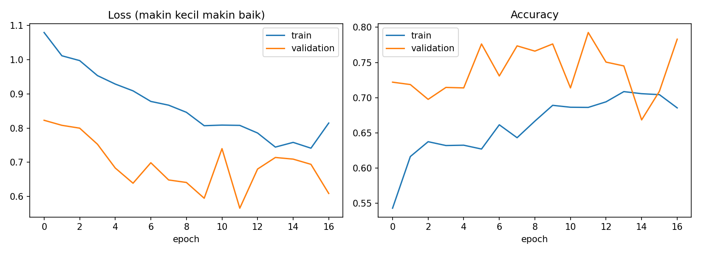
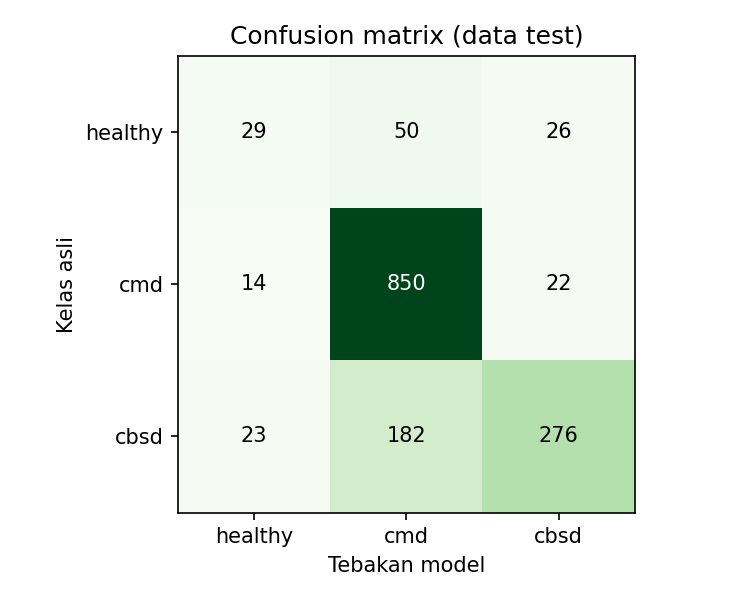
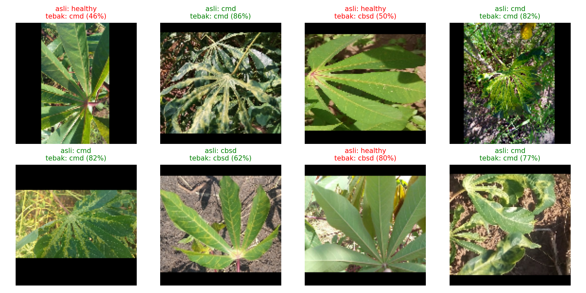

# Klasifikasi Penyakit Daun Singkong Menggunakan Convolutional Neural Network (CNN) pada Dataset iCassava 2019

Tugas Besar Kecerdasan Buatan, S1 Ilmu Komputer, FMIPA, Universitas Halu Oleo. Konteks proyek: SDG 2 (Tanpa Kelaparan).

## Anggota Kelompok

| Nama | NIM |
|---|---|
| RAIHAN AL RAJAB | ISI NIM |
| FATIMAH ALYA SABHIRAH | ISI NIM |
| ANGGUN DIAN MUTIARA | ISI NIM |

## Ringkasan

Proyek ini membangun sebuah CNN dari nol untuk mengklasifikasikan foto daun singkong ke dalam 3 kelas: healthy, cmd, cbsd. Seluruh bobot model dimulai dari angka acak dan dilatih sendiri. Proyek tidak memakai model pra-latih maupun arsitektur lain. Hasilnya dipakai sebagai prototipe skrining berbasis foto, bukan alat diagnosis.

## Latar Belakang dan SDG 2

Singkong adalah tanaman pangan penting di daerah tropis. Gejala penyakit pada daunnya sering mirip satu sama lain, sehingga sulit dibedakan hanya dengan mata. Skrining berbasis foto berpotensi mendukung pemantauan kesehatan tanaman pangan, yang berkaitan dengan target 2.4 SDG 2 (sistem produksi pangan berkelanjutan dan pertanian yang tangguh). Proyek ini tidak mengukur dampak pada hasil panen, jadi klaimnya dibatasi sebagai potensi dukungan pemantauan.

## Dataset

Dataset yang dipakai adalah **iCassava 2019** (Mwebaze et al., 2019), dimuat lewat TensorFlow Datasets dengan nama `cassava`. Dataset berisi foto daun singkong dari Uganda dengan lima kelas asli. Versi proyek ini memakai 3 kelas (healthy, cmd, cbsd) supaya klasifikasi lebih sederhana.

| Kode | Arti |
|---|---|
| CBB | Cassava Bacterial Blight (hawar bakteri) |
| CBSD | Cassava Brown Streak Disease (penyakit garis cokelat) |
| CGM | Cassava Green Mottle (belang hijau) |
| CMD | Cassava Mosaic Disease (penyakit mosaik) |
| Healthy | Daun sehat |

Jumlah foto per kelas (pembagian resmi dari TensorFlow Datasets):

| Kelas | Train | Validation | Test | Total |
|---|---|---|---|---|
| healthy | 316 | 106 | 105 | 527 |
| cmd | 2658 | 887 | 886 | 4431 |
| cbsd | 1443 | 482 | 481 | 2406 |
| **Total** | 4417 | 1475 | 1472 | 7364 |

Catatan tentang data:

- Satu foto hanya memiliki satu label.
- Jumlah foto antarkelas tidak seimbang, sehingga bobot kelas dipakai saat pelatihan (healthy = 4.66, cmd = 0.55, cbsd = 1.02).
- Foto tidak disalin ke repositori ini. Dataset diunduh otomatis lewat kode berikut.

    import tensorflow_datasets as tfds
    train, val, test = tfds.load("cassava", split=["train", "validation", "test"], as_supervised=True)

Informasi sumber dan lisensi dataset: https://www.tensorflow.org/datasets/catalog/cassava

## Metode

### 1. Persiapan data

- Semua foto diubah ke 128 x 128 piksel dengan `tf.image.resize_with_pad`. Bentuk foto dijaga dan sisi yang kurang diberi bingkai kosong.
- Nilai piksel diubah dari 0-255 menjadi 0-1 lewat lapisan `Rescaling`.
- Foto dikelompokkan per 32 (batch), dengan seed acak 42.
- Augmentasi hanya aktif saat latihan: flip horizontal dan vertikal, rotasi acak (faktor 0,1), dan zoom acak (faktor 0,1).

### 2. Arsitektur CNN

Model memakai lapisan dasar Keras. Tidak ada bobot pra-latih dan tidak ada arsitektur lain yang dikombinasikan.

| No | Lapisan | Keluaran | Parameter |
|---|---|---|---|
| 1 | Conv2D (16 filter, 3x3, ReLU) | 128x128x16 | 448 |
| 2 | MaxPooling2D | 64x64x16 | 0 |
| 3 | Conv2D (32 filter, 3x3, ReLU) | 64x64x32 | 4.640 |
| 4 | MaxPooling2D | 32x32x32 | 0 |
| 5 | Conv2D (64 filter, 3x3, ReLU) | 32x32x64 | 18.496 |
| 6 | MaxPooling2D | 16x16x64 | 0 |
| 7 | Flatten | 16.384 | 0 |
| 8 | Dense (64, ReLU) | 64 | 1.048.640 |
| 9 | Dropout (0,5) | 64 | 0 |
| 10 | Dense (softmax) | 3 | 195 |

Total parameter: 1.072.419 (semuanya dilatih).

### 3. Pelatihan

| Pengaturan | Nilai |
|---|---|
| Optimizer | Adam, learning rate 0,001 |
| Loss | Sparse categorical crossentropy |
| Batch | 32 |
| Epoch maksimum | 30 (epoch yang dijalankan: 17) |
| Early stopping | Berhenti bila val_loss tidak membaik selama 5 epoch, lalu bobot terbaik dipulihkan |
| Penyimpanan model | ModelCheckpoint pada val_loss terbaik |
| Bobot kelas | N / (K x jumlah foto kelas) |

### 4. Evaluasi

Model dinilai pada data test yang tidak dipakai saat latihan maupun saat memilih model. Metrik yang dilaporkan: accuracy, macro-F1, balanced accuracy, confusion matrix, dan classification report.

## Hasil

Jumlah foto test: 1472.

| Metrik | Nilai |
|---|---|
| Accuracy | 0.7846 |
| Macro-F1 | 0.6296 |
| Balanced accuracy | 0.6031 |

Classification report:

                  precision    recall  f1-score   support
    
         healthy      0.439     0.276     0.339       105
             cmd      0.786     0.959     0.864       886
            cbsd      0.852     0.574     0.686       481
    
        accuracy                          0.785      1472
       macro avg      0.692     0.603     0.630      1472
    weighted avg      0.783     0.785     0.768      1472

Macro-F1 dan balanced accuracy ikut dilaporkan karena jumlah foto per kelas tidak seimbang, sehingga accuracy saja dapat menyesatkan. Tabel di atas menunjukkan kelas yang paling sulit dikenali model.

## Aplikasi Web

Aplikasi dibuat dengan Gradio. Cara menjalankan di komputer sendiri:

    git clone https://github.com/raihanrajakomputer/SDGS2-AI.git
    cd SDGS2-AI
    pip install -r requirements.txt
    python app.py

Buka alamat yang tampil di terminal (biasanya http://127.0.0.1:7860), unggah foto daun, lalu klik Klasifikasikan. Aplikasi menampilkan skor tiap kelas. Skor tertinggi di bawah 50% memunculkan pesan "Bukan termasuk kategori daun singkong!". Pengaman ini hanya heuristik: foto non-daun dapat lolos dengan skor tinggi, dan foto daun yang kurang jelas dapat ditolak.

## Struktur Repositori

    SDGS2-AI/
    ├── app.py
    ├── requirements.txt
    ├── SDGS2_CNN_Revisi.ipynb
    ├── app_artifacts/
    │   ├── best_model.keras
    │   ├── class_names.json
    │   └── metadata.json
    ├── plots/
    └── reports/

## Batasan

- Data berasal dari Uganda, sehingga kecocokan dengan kondisi Indonesia belum diuji.
- Satu foto hanya punya satu label, padahal satu tanaman bisa terkena lebih dari satu gangguan.
- Prediksi berbasis foto, bukan uji laboratorium.
- Model sederhana dan dilatih dari nol, sehingga akurasi bukan tujuan utama.
- Penolakan foto non-daun bersifat heuristik.

## Catatan Revisi

Versi awal proyek memakai EfficientNetB0 pra-latih dan lima kelas. Atas arahan dosen, versi ini diganti dengan CNN murni buatan sendiri dan 3 kelas.

## Referensi

Mwebaze, E., Gebru, T., Frome, A., Nsumba, S., & Tusubira, J. (2019). *iCassava 2019 fine-grained visual categorization challenge*. arXiv preprint arXiv:1908.02900. https://arxiv.org/abs/1908.02900

TensorFlow Datasets. (n.d.). *cassava: Dataset catalog*. https://www.tensorflow.org/datasets/catalog/cassava

United Nations. (n.d.). *Goal 2: End hunger, achieve food security and improved nutrition and promote sustainable agriculture*. https://sdgs.un.org/goals/goal2
